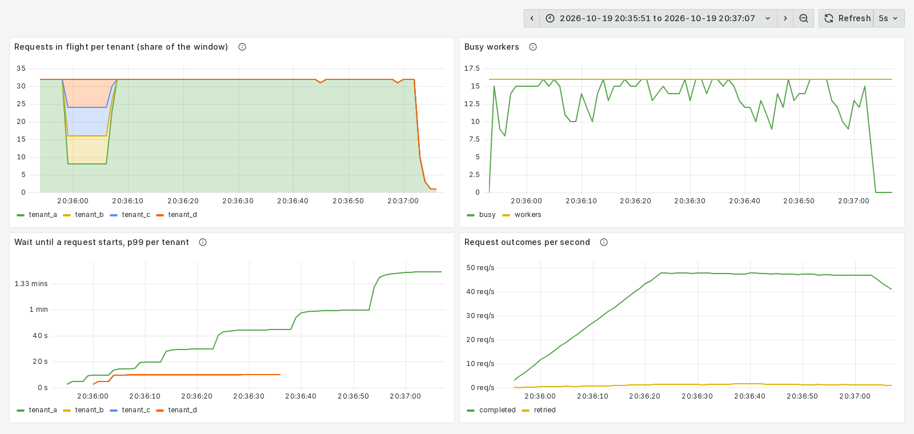
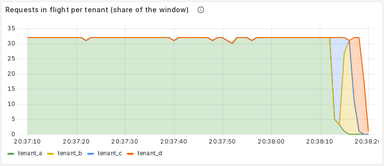

# batch-inference

[](https://github.com/ananya-mh/batch-inference/actions/workflows/ci.yml)

A multi-tenant batch inference service in Go. Upload a file of AI requests, and the service runs them in the background on a shared model and gives back a results file. It follows the [OpenAI Batch API](https://platform.openai.com/docs/guides/batch), so the official OpenAI SDKs work against it unchanged, and it can send work to any OpenAI-compatible model server (vLLM, Ollama, or a hosted provider). It is built to be fair across tenants, never lose work, never save a result twice, and survive crashes.

**Status:** work in progress. Done: files, batches, workers, results files, cancel, expiry, fair scheduling across tenants, Prometheus metrics with a Grafana dashboard, and CI. Still to come: the full-size load test and a run on a real GPU.

## Run it

```sh
docker compose up                        # Postgres, the server on :8080, and a fake model on :8000
docker compose --profile monitoring up   # the same, plus Prometheus on :9090 and Grafana on :3000
go test -race ./...                      # needs the Postgres from docker compose running
```

The fake model pretends to be an AI model, so no GPU is needed: it waits 50 to 500 ms per request, fails 2% of requests, and cuts off 1% of replies halfway, so retries are exercised all the time. Development tenants and API keys (`sk-dev-tenant-a` to `sk-dev-tenant-d`) are set in `compose.yaml`.

**CI** ([`.github/workflows/ci.yml`](.github/workflows/ci.yml)) runs on every push and pull request: gofmt, `go vet`, and `go test -race ./...` against a real Postgres (started with `max_connections=300`, as in `compose.yaml`); shellcheck on the scripts; and both crash tests (`scripts/crash-test.sh 500` and `--expiry 500`) against the full Docker Compose stack.

## Use it with the OpenAI SDK

```python
from openai import OpenAI

client = OpenAI(base_url="http://localhost:8080/v1", api_key="sk-dev-tenant-a")

batch_file = client.files.create(file=open("tickets.jsonl", "rb"), purpose="batch")
batch = client.batches.create(
    input_file_id=batch_file.id,
    endpoint="/v1/chat/completions",
    completion_window="24h",
)
# ... later
batch = client.batches.retrieve(batch.id)
print(batch.status, batch.request_counts)
results = client.files.content(batch.output_file_id).text
```

Each line of the input file is one request, in OpenAI's format:

```json
{"custom_id": "ticket-1", "method": "POST", "url": "/v1/chat/completions", "body": {"model": "fake", "messages": [{"role": "user", "content": "Classify: my invoice is wrong"}]}}
```

## API

| Endpoint | What it does |
|----------|--------------|
| `POST /v1/files` | Upload a batch input file (multipart, `purpose=batch`). Checked line by line as it streams in; errors name the line, e.g. `line 3: duplicate custom_id "a"`. Up to 100 MB. |
| `GET /v1/files/{id}` | A file's details. |
| `GET /v1/files/{id}/content` | Download a file (input, results, or errors), streamed. |
| `POST /v1/batches` | Start a batch from an uploaded file. |
| `GET /v1/batches/{id}` | Status and progress (`request_counts`: total, completed, failed). |
| `GET /v1/batches` | List your batches, newest first, with OpenAI-style paging (`limit`, `after`, `has_more`). |
| `POST /v1/batches/{id}/cancel` | Cancel a batch. |

Requests use `Authorization: Bearer <api key>`. A tenant only ever sees its own files and batches; another tenant's ID gets the same 404 as one that doesn't exist.

Results come back in two files, in OpenAI's format: `output_file_id` (successful requests) and `error_file_id` (failed, cancelled, and expired requests; `null` if there are none). Every `custom_id` from the input appears in exactly one of them.

## How it works

- **Postgres holds everything**: uploaded files (one row per line), batches, requests, results, and the job queue ([River](https://riverqueue.com)).
- **A batch's lines wait in a `requests` table**, not all in the queue at once. A scheduler keeps a fixed number of them (the window, default 32) in River at a time and refills slots as requests finish.
- **Fair scheduling:** each free slot goes to the tenant with the fewest requests in flight (ties: whoever's oldest request has waited longest). A tenant alone gets the whole window; when a second tenant arrives, freed slots go to it until both have an equal share. So a small batch gets going within a fraction of a second even while another tenant's huge batch is running, instead of waiting for all of it.
- **Workers** call the model, read the *whole* reply before trusting it (a reply cut off midway is a failed attempt, never a result), and retry temporary failures quickly (1, 2, 4, 8 seconds; up to 5 attempts).
- **Statuses only change by compare-and-set** (`UPDATE ... WHERE status = <expected>`), so when two things race (cancel against finishing, expiry against cancel, two servers at once) exactly one wins.

## Guarantees and the tests that check them

| Guarantee | How | Tests |
|-----------|-----|-------|
| **No lost work.** A request whose worker crashes is retried. | Each request's job stays in Postgres; River rescues jobs left running by a dead worker. A request interrupted by a shutdown runs again without using up an attempt. A job that dies on every attempt is failed with a reason, never left hanging. | `TestStuckJobIsRescuedByRiver`, `TestRetryAfterCrashedAttemptFinishes`, `TestShutdownMidRequestKeepsItsAttempt`, `TestRequestOfDeadJobIsGivenUp`, `TestFinalizingSurvivesCrash`, `scripts/crash-test.sh` |
| **No duplicate results.** Each result is saved once, keyed by `batch_id + custom_id`. | Saving moves the request out of `running` by compare-and-set, so only one attempt can save; the results table's primary key backs it up. | `TestSameRequestRunTwiceSavesOneResult`, `TestConcurrentFinishSavesOnlyOnce`, `TestTwoSchedulersNeverOverfillWindow` |
| **Cancel works.** After cancel, no new requests from that batch start. | Cancel and the worker's start check lock the batch row against each other; requests not yet running are cancelled at once and their slots freed. | `TestCancelMidBatch`, `TestCancelInProgressBatch`, `TestStartCancelsRequestOfCancellingBatch`, `TestCancelAndFinalizeRace`, `TestCancelAndFanOutRace` |
| **Fairness.** A tenant with a huge batch cannot block a tenant with a small one. | Free slots go to the tenant with the fewest requests in flight, so a newly arriving tenant gets slots as soon as any free up. | `TestSmallTenantNotBlockedByBigBatch`, `TestArrivingTenantGetsFreedSlots`, `TestLoneTenantGetsWholeWindow`, `TestNewTenantGetsFreedSlots`, `scripts/fairness-experiment.sh` |
| **Expiry works.** Unfinished requests are marked expired when the window ends. | Deadlines are checked against the database's clock; at the deadline, unfinished requests expire and late results are dropped. | `TestExpiryMidBatch`, `TestOverdueBatchExpires`, `TestExpiryAndLastResultRace`, `TestUndoneExpiryIsNeverVisible`, `TestExpiryAndCancelRace`, `scripts/crash-test.sh --expiry` |

**Invariants checked after every end-to-end test.** Whatever a test did (crashes, cancels, expiry, races), once its workers stop, `testfixtures.CheckIntegrity` checks that: every queued or running request has a River job for it; no two requests share a job; results exist exactly for succeeded and failed requests; a finished batch has no unfinished requests and lists every `custom_id` exactly once across its two files; file line counts are right; and no batch has more than one ending. A test breaks each invariant on purpose to make sure the checks notice.

## Crash tests

`scripts/crash-test.sh` shows the service surviving a hard crash. It starts a batch of 2,000 requests, kills the server with `SIGKILL` partway through (no chance to clean up), starts it again, and checks the database. It needs Docker with Compose and `curl`, and exits non-zero if any check fails.

```sh
scripts/crash-test.sh            # kill mid-batch, restart, the batch must complete
scripts/crash-test.sh --expiry   # kill mid-batch and stay down past the batch's deadline
```

A real run of the first:

```
==> Killing the server with SIGKILL (32 requests in flight, 18 mid-call to the model)

==> Checking the database
  ok    batch completed
  ok    every custom_id is in exactly one output file (2000 lines, 2000 distinct)
  ok    no request has more than one result (2000 results, 2000 distinct)
  ok    the crash really interrupted work (18 requests were mid-call)
  ok    every request has exactly one result (2000 of 2000)

==================== crash test summary ====================
 Mode:                      normal
 Result:                    PASS
 Requests in batch:         2000
 Killed at:                 205 done, 32 in flight (18 mid-call)
 Jobs rescued by River:     15
 Jobs retried (any reason): 65
 Results saved:             2000 (2000 distinct custom_ids)
 Succeeded / failed:        2000 / 0
 Finished after restart:    40s
 Results / errors file:     2000 / 0 lines
=============================================================
```

The `--expiry` variant gives the batch a 30-second completion window and keeps the server down until 10 seconds after the deadline. After the restart, the overdue batch must expire promptly, keep the results saved before the deadline, and keep nothing saved after it:

```
  ok    batch expired
  ok    every custom_id is in exactly one output file (2000 lines, 2000 distinct)
  ok    every request finished before the deadline or expired (219 + 0 + 1781)
  ok    no result saved after the deadline was kept (0)
  ok    expired requests say batch_expired in the errors file (1781)
  ok    expired within 5s of the restart (0s)
```

For these tests the server rescues jobs of a dead worker after 20 seconds instead of the usual 5 minutes.

## Fairness experiment (noisy neighbor)

Tenant A submits one big batch; 5 seconds later tenants B, C and D each submit a small one. The same scenario runs with fair scheduling and with first come, first served, 5 times each, under identical conditions: same input files, same arrival timing, and the same fake model seed (so every request gets the same delay and the same errors in every run; the fake model is restarted before each run). Settings as in `compose.yaml`: 16 workers, a window of 32, fake model at 50–500 ms per request.

```sh
scripts/fairness-experiment.sh                 # defaults: 3,000-request big batch, 3 x 100-request small ones
BIG=50000 scripts/fairness-experiment.sh       # the full-size experiment (not yet run)
```

A real run, `RUNS=5 BIG=3000 SMALL=100 SMALL_DELAY=5 SEED=42 ERROR_RATE=0.02 CRASH_RATE=0.01 scripts/fairness-experiment.sh` (raw data: [per-run CSV, busy-worker samples, and chart](docs/results/fairness-2026-10-19-normal-rates/)):

Tenant A: one batch of 3000 requests. Tenants B, C, D: one batch of 100 requests each, submitted 5s after A's.
Fake model: 50–500 ms per request, error rate 0.02, cut-off-reply rate 0.01, seed 42. 16 workers, window of 32.
5 runs per mode, same seed and arrival timing; values are median [min–max] over the runs.
Every time is measured from that tenant's own submission (when its batch was created), in seconds.

| Metric | Fair scheduling | First come, first served |
|---|---|---|
| Small tenants: batch done, from its submission (slowest of B, C, D) | 9.17 [9.05–9.18] | 66.04 [65.23–66.07] |
| Small tenants: wait from submission until a request's model call starts, p50 | 4.48 [4.47–4.49] | 61.56 [61.46–61.71] |
| Small tenants: same wait, p99 | 8.61 [8.51–8.61] | 64.68 [64.53–64.73] |
| Small tenants: wait from submission until the first request gets a slot (slowest) | 0.07 [0.04–0.08] | 62.23 [62.17–62.32] |
| Big tenant: batch done, from its submission | 73.52 [73.32–73.72] | 66.8 [66.65–66.82] |
| Total throughput: all requests / (last batch done − first batch submitted), requests/s | 44.9 [44.8–45] | 46.4 [46.4–47] |
| Busy workers, average over the run (of 16) | 13.1 [13–13.1] | 13.5 [13.4–13.7] |
| Idle worker-seconds over the run | 215 [213–218] | 174 [164–185] |
| Busy workers, average over the last 10 s of the run | 9 [8.5–9.2] | 12.5 [12.1–13.1] |

Jobs retried per run (same seed, so this should match across runs): 92, 92, 92, 92, 92, 92, 92, 92, 92, 92.

```
Median time from submission until done (seconds)
small, fair      9.2  #####
small, fifo     66.0  ####################################
big,   fair     73.5  ########################################
big,   fifo     66.8  ####################################
```

What it shows: with fair scheduling the small tenants get their first slot within 0.1 s of submitting and finish about 9 s after submitting; first come, first served makes them wait about 62 s for the big batch to get out of the way. The cost is that the big batch finishes about 7 s (10%) later, since it shares the window. Total throughput is about 3% lower with fair scheduling in this run; the next section explains why.

### Investigating the throughput gap

The hypothesis: with fair scheduling the big tenant finishes last, so its final retries hold slots during their backoff while the other workers sit idle. Two checks.

**(a) Turn errors and cut-off replies off.** If retries cause the gap, it should disappear. It does: throughput is the same in both modes ([raw data](docs/results/fairness-2026-10-19-no-errors/)). From `RUNS=5 BIG=3000 SMALL=100 SMALL_DELAY=5 SEED=42 ERROR_RATE=0 CRASH_RATE=0 scripts/fairness-experiment.sh`:

| Metric | Fair scheduling | First come, first served |
|---|---|---|
| Small tenants: batch done, from its submission (slowest of B, C, D) | 8.84 [8.84–8.97] | 63.25 [63.24–63.26] |
| Small tenants: wait from submission until a request's model call starts, p50 | 4.26 [4.26–4.32] | 59.6 [59.56–59.63] |
| Small tenants: same wait, p99 | 8.29 [8.19–8.39] | 62.65 [62.59–62.66] |
| Small tenants: wait from submission until the first request gets a slot (slowest) | 0.03 [0.01–0.03] | 60.31 [60.18–60.37] |
| Big tenant: batch done, from its submission | 68.31 [68.12–68.33] | 62.01 [61.95–62.03] |
| Total throughput: all requests / (last batch done − first batch submitted), requests/s | 48.3 [48.3–48.4] | 48.3 [48.3–48.3] |
| Busy workers, average over the run (of 16) | 13.4 [13.3–13.5] | 13.5 [13.4–13.5] |
| Idle worker-seconds over the run | 178 [167–181] | 172 [171–179] |
| Busy workers, average over the last 10 s of the run | 13.2 [12.7–13.5] | 13.1 [12.9–13.4] |

**(b) Look for an idle tail.** With the normal error rates (the first table above), the last 10 seconds of the fair runs average 9.0 busy workers out of 16, against 12.5 first come, first served, and the fair runs have about 41 more idle worker-seconds in total. With errors off, the tails are the same (13.2 against 13.1).

**What causes it.** The last job to finish in every fair run is the same request, `a-2341`, on its fifth attempt: with seed 42 the fake model fails it four times in a row, so its retries wait 1 + 2 + 4 + 8 seconds. Under fair scheduling the big tenant's requests are reached later (they share the window), so this request starts about 18 s before the end and its retry chain *is* the end of the run, with the other workers idle during its last backoff. Under first come, first served it starts about 22 s before the end and finishes about 4 s early, while the small tenants' requests keep the workers busy. Query used, on the database after the run:

```sql
-- For each run, request a-2341's attempts and when it finished/was queued relative to the run's end.
WITH runs AS (
  SELECT metadata->>'experiment' AS tag, max(completed_at) AS ended FROM batches
  WHERE metadata->>'experiment' ~ '^(fair|fifo)-' GROUP BY 1 HAVING sum(request_total) = 3300)
SELECT r.tag, j.attempt,
       extract(epoch FROM r.ended - j.finalized_at) AS done_s_before_end,
       extract(epoch FROM r.ended - j.created_at)  AS queued_s_before_end
FROM runs r JOIN batches b ON b.metadata->>'experiment' = r.tag
JOIN river_job j ON j.args->>'batch_id' = b.id AND j.args->>'custom_id' = 'a-2341';
```

which gave 5 attempts in all 10 runs, done 0.1–0.2 s before the end in the fair runs and 3.5–4.5 s before the end in the first-come runs.

So the gap is a tail effect of one unlucky request's retry chain, not a slowdown while the batch is running: on average over the run, 13.1 against 13.5 workers are busy, and most of that difference is the tail. It would shrink as the big batch grows.

## Metrics

The server serves Prometheus metrics at `http://localhost:8080/metrics`, and `docker compose up` starts a Prometheus at `http://localhost:9090` that scrapes it every second. Labels are only ever `tenant` and `outcome`, never a batch or request ID (a test checks this), so the number of time series stays small however many batches run.

| Metric | Type | Labels | What it measures |
|--------|------|--------|------------------|
| `batch_workers_busy` | gauge | | Workers on this server running a request right now |
| `batch_workers_total` | gauge | | Workers on this server |
| `batch_requests_in_flight` | gauge | `tenant` | Requests holding a slot in the window (in River or running, including waiting for a retry) |
| `batch_requests_waiting_for_retry` | gauge | `tenant` | In-flight requests waiting out a retry delay |
| `batch_queue_depth` | gauge | `tenant` | Requests waiting in the scheduler's table for a slot |
| `batch_request_wait_seconds` | histogram | `tenant` | From a batch's submission until a request's model call first started |
| `batch_request_outcomes_total` | counter | `tenant`, `outcome` | Requests by outcome: `completed`, `failed`, `retried` (one per retried attempt), `expired`, `cancelled` |
| `batch_model_call_seconds` | histogram | `outcome` | Model call duration, `success` or `error` |
| `batch_scheduler_pass_seconds` | histogram | `outcome` | Scheduler pass duration, `ran` or `skipped` (another server held the lock) |

The three per-tenant gauges are read from Postgres at each scrape and describe the whole service, so with several servers take `max()` of them across servers, not `sum()`. Outcomes are counted only after the database change that caused them commits, so rolled-back work is never counted.

### Dashboard

`docker compose --profile monitoring up` also starts Grafana at `http://localhost:3000` with a "Batch inference" dashboard (provisioned from `deploy/grafana/`, no login needed to view): each tenant's share of the window, busy workers, p99 wait per tenant, and outcomes per second.

This is the fair-scheduling run of a real experiment. Tenant A's 3,000-request batch holds all 32 slots until tenants B, C and D submit 100 requests each; A then drops to 8 slots while each of them gets 8, and takes the whole window back once they finish. The small tenants' p99 wait stays around 10 s while tenant A's own queue keeps growing:



The first come, first served run right after it, for contrast (just the share-of-the-window panel): tenant A keeps all 32 slots until it is done, and only then do B, C and D get in.



Produced with:

```sh
docker compose --profile monitoring up -d
RUNS=1 scripts/fairness-experiment.sh                      # one fair run, then one first-come run
scripts/grafana-screenshot.sh fair-1-1792442151 docs/images/grafana-fair-scheduling.png
scripts/grafana-screenshot.sh fifo-1-1792442227 fifo.png   # then cropped to the top-left panel
```

The run tags come from the batches' metadata (`fair-1-…`, `fifo-1-…`); the run's raw results are in [`docs/results/fairness-2026-10-19-screenshot-run/`](docs/results/fairness-2026-10-19-screenshot-run/). The first-come image shows only the share-of-the-window panel because the other panels average over 30 seconds, so their first 30 seconds still include the end of the fair run before it.

**Repeating the throughput investigation with metrics** (instead of the experiment script's own sampler), in Prometheus at `http://localhost:9090`:

```promql
sum(batch_workers_busy)                                     # busy workers over time: look for an idle tail
sum by (tenant) (batch_requests_waiting_for_retry)          # who holds slots while waiting for a retry
sum by (tenant) (batch_requests_in_flight)                  # each tenant's share of the window
histogram_quantile(0.99, sum by (tenant, le) (rate(batch_request_wait_seconds_bucket[1m])))  # p99 wait per tenant
sum by (outcome) (rate(batch_request_outcomes_total[1m]))   # completed, retried, failed per second
```

## Settings

| Variable | Default | Meaning |
|----------|---------|---------|
| `DATABASE_URL` | (required) | Postgres connection string |
| `MODEL_BASE_URL` | `http://localhost:8000/v1` | Any OpenAI-compatible server (the fake model, vLLM, ...) |
| `MODEL_API_KEY` | (none) | Only needed for hosted providers |
| `WORKERS` | 16 | Requests sent to the model at once |
| `SCHEDULER_WINDOW` | 2 × `WORKERS` | Most requests in the queue at once |
| `FAIR_SCHEDULING` | `true` | `false` = first come, first served (the experiment's baseline) |
| `MAX_ATTEMPTS` | 5 | Tries per request |
| `JOB_TIMEOUT` | 2m | Longest one model call may take |
| `COMPLETION_WINDOWS` | `24h` | Allowed completion windows (tests add short ones like `10s`) |
| `MAX_UPLOAD_BYTES` | 104857600 | Upload size limit (100 MB) |
| `SEED_TENANTS` | (none) | Tenants to create at startup: `tenant_a=key,tenant_b=key` |
